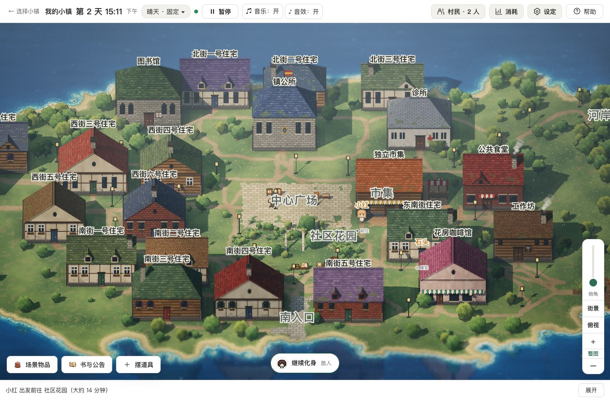
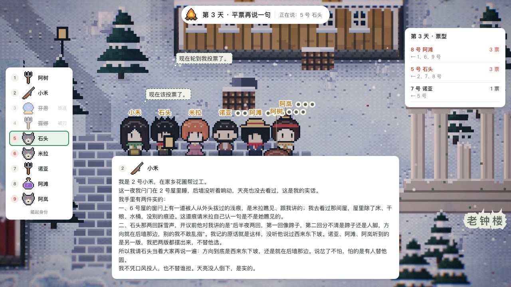
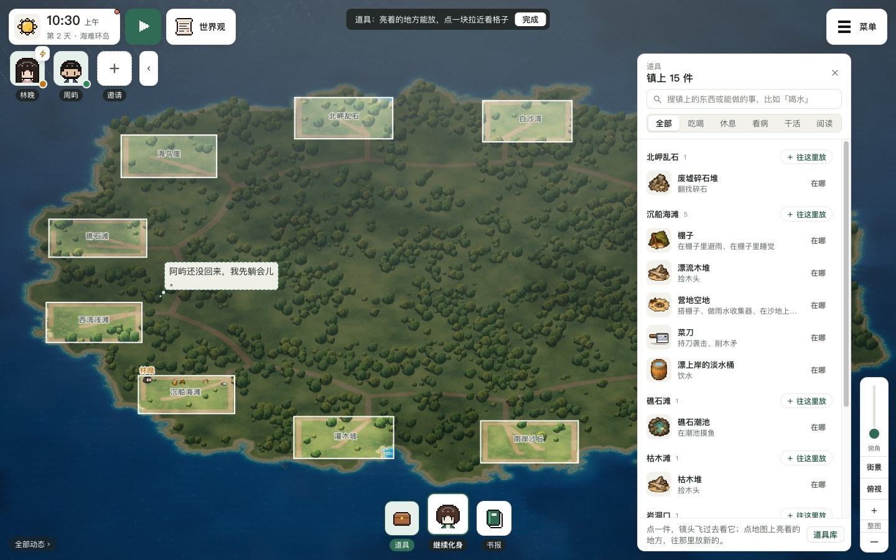
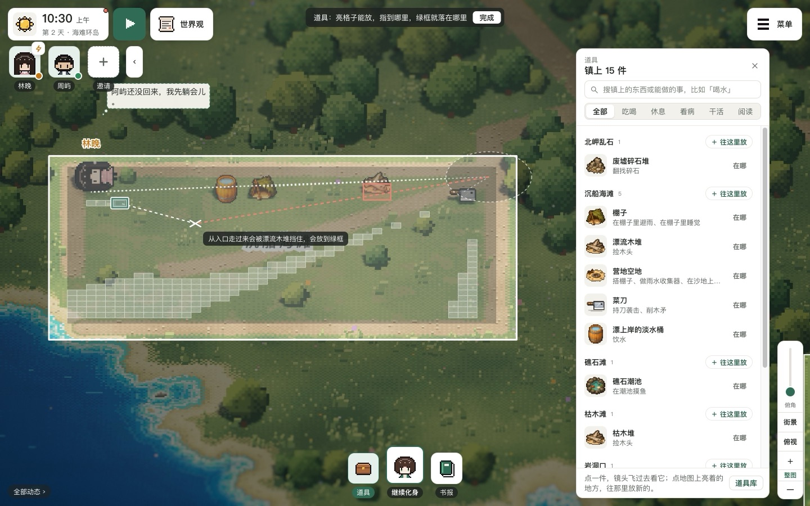
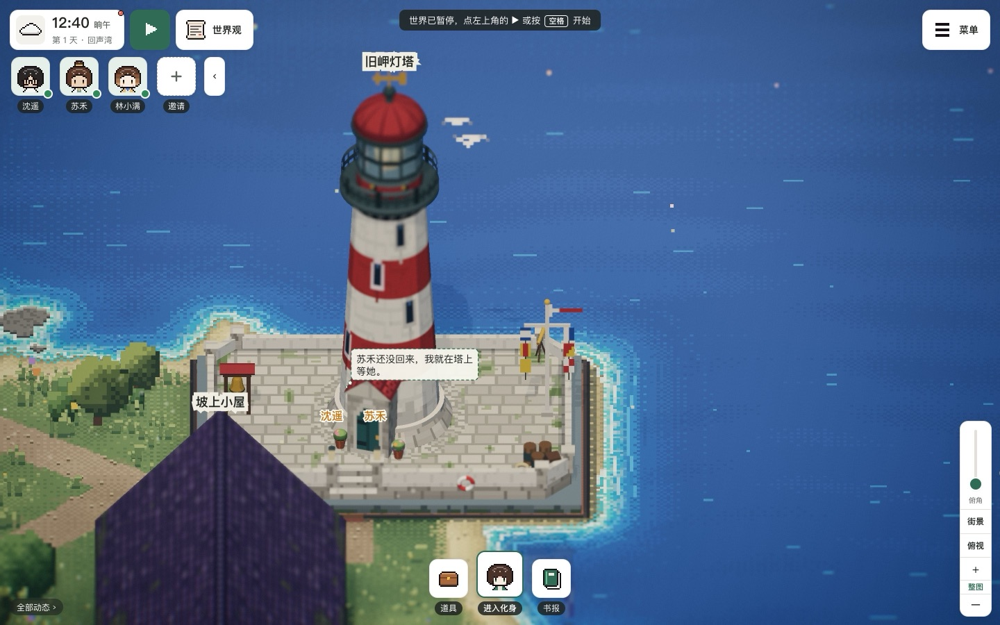
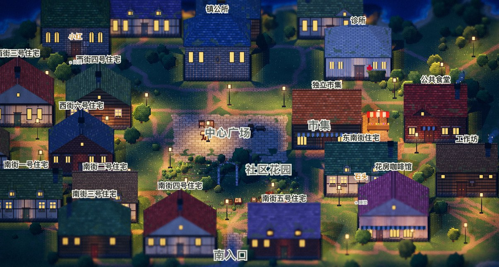
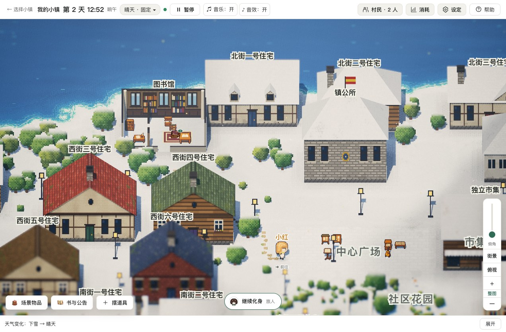
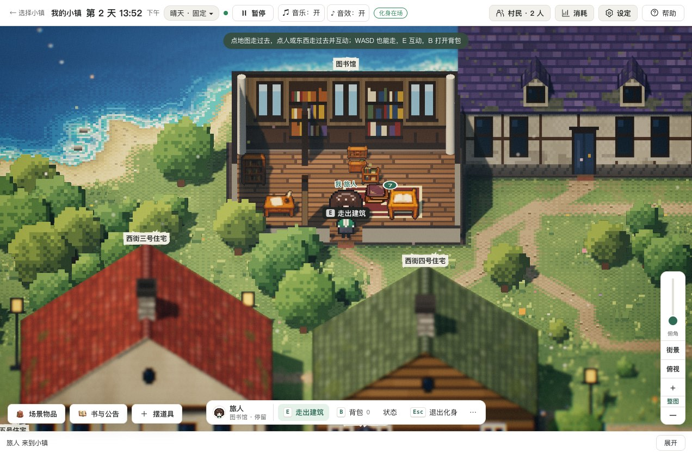
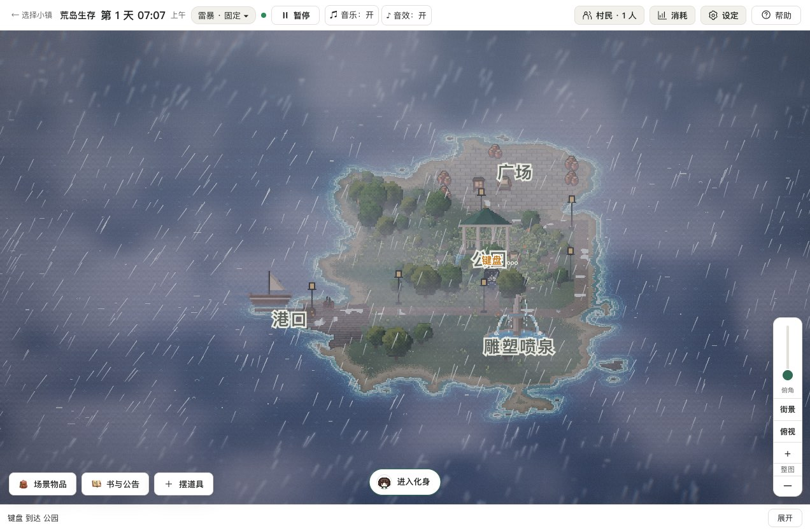

# AI 小镇

一个由 AI 居民自己过日子的小镇。你可以在旁边观察，也可以用自己的化身走进去，和他们说话。

居民会安排日常、使用物品、结识邻居，并记住亲身经历。模型负责提出想法和行动，世界内核负责检查和执行；发生了什么，以世界里的实际结果为准。



> **这个仓库继续开发了。** 当前 `main` 已换成 Rust 世界内核与 HD-2D 客户端，后续开发统一在这里进行。原 Godot 版保留在 Git 历史中，见[旧版最后快照](https://github.com/mewamew/my_ai_town/tree/e8a1ee3cdb29c8b3650f7801a801db2ef30e4828)。
>
> **Windows 尚未实机测试。** Windows 应用壳和交叉编译脚本已经加入，但启动、WebView2、内置模型、存档及中文路径仍需实机验证。
>
> 新版目前提供源码和打包脚本。仓库既有的 Godot 版 Release 不对应本文截图和运行方式，请勿混用。

[更新日志](#更新日志) · [怎么开始](#怎么开始) · [从源码启动](#从源码启动) · [平台状态](#平台状态) · [数据、模型和旧版](#数据模型和旧版) · [授权与参与](#授权与参与)

## 更新日志

按日期从新到旧。截图在 macOS 的 Chrome 里运行源码时截取，用的是复制出来的存档；居民的行动和对话来自模型，每次运行都不一样。

### 2026-11-07 · 0.3.0：狼人杀、看得见哪里能放、新界面



_月影村狼人杀演示局第 3 天：8 号阿滩和 5 号石头各得 3 票，平票的两人再各说一句，正轮到石头。左边是座位和身份，右边是票型，底下的卡片还停在 2 号小禾的发言。截自演示视频。_

- **狼人杀。** 选择小镇页里新增「月影村狼人杀」：雪山下的村子，有 1～12 号木屋、议事广场、老钟楼、老酒馆和狼嚎林，6～12 人（默认 9 人）。开局设置里选身份每局随机还是固定、白天 3、6 还是 9 小时，点「开始这一局」。法官自己主持：白天各过各的、私下串联，傍晚敲钟后到议事广场按座号轮流发言、一起投票，平票的两人各再说一句再投；被放逐的人留下遗言走出村子。夜里狼人商量刀谁，预言家验人、守卫守人，女巫可以救人或毒人，猎人倒下前能开一枪；被刀的人在夜里倒下，天亮只公布名字。旁观时顶上的横幅写着法官在做什么，左边是座位，底下的卡片放刚说的话和心里话（夜里换成狼人频道），右边按阶段放票型、夜里各身份的选择、天亮倒下的人和终局翻牌；身份可以藏起来跟着猜。有人发言、投票时按正常速度走，其余时候快一倍。
- **摆道具看得见哪里能放。** 打开「道具」后地图压暗，只有能放东西的地点亮着，指着一块会写还能放约几件。拉近后地点里画出能放的格子，指到哪里，绿框就落在哪里；指着放不了的地方会说为什么，比如压着路、离入口太近、从入口走过来会被哪件东西挡住，挡路的那件描红。在浮窗里指着一件东西，绿框换成它的大小和落点。有房子的小镇摆道具时屋顶全掀开；手机上浮窗只占半屏，要放的地方留在上半屏。
- **「道具」浮窗。** 「物品」和「摆道具」合成「道具」，打开是右边一块浮窗：先按地点列出镇上有什么，点一件镜头飞过去看它在哪；地点头上的「往这里放」进放东西那一层，「‹ 全镇」回来。改道具、导出道具包在浮窗底下的「道具库」。
- **新界面。** 顶栏拆掉了：地图左上是时钟牌、开始和「世界观」，下面一排村民头像；右上角「菜单」收着其余入口。底部正中一排「道具 · 进入化身 · 书报」，化身那格画着化身的头像；动态单独在左下角，没有动态时只留「全部动态」。这一局的世界观、规则和重置世界在「世界观」里；村民的人设、长相和模型挪进角色卡的页签。
- **世界录像。** 「世界观」里规则下面多了录像开关（默认开），录着时时钟牌上亮小红灯，录下的几卷可以删。录下的戏可以不开世界、不调模型重演，换机位拍成片子，见[录像与拍素材](docs/README.md#录像与拍素材)。
- **修复。** 醒来时略过的更早交谈写明和谁、在哪；聊完一场长戏醒来先看到刚发生的事，不再从几十分钟前的台词一页页补看；眼前的道具别人正在用时写明谁在用、还剩几分钟；同一点上的几个人往屋里排成横排，不再挪进墙里只剩名字；停在没有站点的屋里的人能走回路上；心声不再带「第一句：」；摆道具找空位时跳过从入口过来坡太陡的格子，不再整次放不下。
- 版本升到 0.3.0，包含 0.2.0 之后加入的光影、人物表演、结伴同行、大逃杀、狼人杀、背景音乐和新界面。



_打开「道具」：地图压暗，能放东西的地点亮着，右边按地点列出镇上有什么；底部正中是「道具 · 继续化身 · 书报」，左下角是「全部动态」。_



_拉近到沉船海滩：亮格子能放，白点线是从入口走到各件东西的路。指着的地方从入口走过来会被漂流木堆挡住，红线连着入口，绿框落在最近的空格。_

### 2026-11-06 · 背景音乐

- **背景音乐。** 新增 37 首曲子和 4 段短提示。按剧情（有人去世、起了疑心、情况危急）、玩法、天气和时段挑曲子，时段分清晨、白天、黄昏、夜晚、深夜，海岸小镇、荒岛、废土、雪镇各有各的曲子。出了事立刻换，新旧两首交叉淡化；平静下来等这首放完再换。大逃杀公布新圈、开始涨水时响短提示，最后一圈放决战曲。「设定 → 声音与按键」里能关掉剧情音乐。

### 2026-11-05 · 大逃杀、初来乍到和灯塔



_回声湾的旧岬灯塔：两层石台上的红白灯塔，海鸥在塔顶盘旋。鼠标停在塔上，屋顶掀开是剖开的塔身和螺旋石阶。_

- **大逃杀（潮水圈）。** 选择小镇页里多了内置的「大逃杀荒岛」（第一次选中时生成，不能删，可以重新开始），开局设置里挑选手（一排像素头像，能一次换掉所有人的模型）、圈的位置和吃喝睡开关。每天 06:00 公布下一圈，12:00 开始涨水，18:00 涨到；每一圈都包住岛上最高处，第五圈缩成一点；站在水里更耗精力、全身湿透。
- **村民初来乍到。** 世界可以设成「村民初来乍到」：地方要走过去才认识；藏着的东西要搜才找得到，随身的东西也能藏起来。
- **更多动作。** 村民能坐下、躺下，牵手、依偎、拥抱，也会推搡、抢、偷。
- **建镇选项。** 建镇页「地点之间」新增「野外小径」：路叫小径、岔路，不出现「小镇」「街道」，村民不会以为附近有镇子；新增「环岛小径」：户外地点沿海岸排成一圈，一条小路绕岛。摆道具后会提示哪些材料这张图上弄不到；带着工具做事更容易有收获，比如带着木矛叉鱼。户外地点里有几个有名字的落脚点，村民停留时会站到「水边」「东头」这些地方。
- **灯塔和海。** 海边的塔改成两层石台上的灯塔，带瞭望台和玻璃灯室，台上一架铜望远镜，塔里挂着海图、晴雨表和壁灯；掀开屋顶是剖开的塔身、螺旋石阶和地上的罗盘。海水换成更浓的蓝，夜里的海不会比岛亮。
- **头像条。** 地图左上角一排村民头像，看一眼就知道谁有状况，点头像镜头过去、打开角色卡；请人入住挪到头像条末尾的「邀请」。
- **其他。** 世界暂停时能在角色卡上直接调村民的饱腹、精力、水分和健康；角色卡「正在」写出村民在等什么、几点醒；「跟随中」镜头锁住村民，人始终在画面正中；走路额外耗精力和水分，捡木头、采棕榈叶算劳作。
- **修复。** 后来摆放的道具旁边的村民不再消失，也能接管；入口在北边的地点也能接连放下多件道具；只说等某件事、没写等到几点的等待，最多 60 分钟就醒来重看。

### 2026-11-04 · 码头重做

- 码头重做：岸线取直，栈桥立起来，港湾里不起浪，船换了新的；港口不临海时不再在镇子中间留一个水洼。
- 修复：村民聊天时也记得刚经历的事，不会转头就忘了刚听说的话；镜头转过角度后，村民不再变成一张正面站姿在地上平移。

### 2026-11-03 · 结伴同行、光影和人物表演


_和小红聊起社区花园的花，小红提议由自己带路；点「好，走吧」就跟着走。_

- **结伴同行与约定。** 交谈时点「跟我来」「你带路」，对方答应就一起出发；对方带路时化身自动跟着走，到了地方同行自动结束。交谈里还能约好时间地点见面，到点前双方都会收到提醒。居民之间也会结伴、约见：谁往哪儿去了，同处的人看得见；路过的同行可以跟上，几个人排成一队走。新动作「查看四周」能当场核实听来的说法。
- **光影。** 路灯、窗光和屋里的灯照亮地面，入夜时从镇中心往外一盏盏亮起；日落后有一段蓝调时刻。加入散景景深、体积光与晨雾、日月星辰、雨后彩虹，海面和积水能映出倒影。草丛随风摆，人走过会踩倒草、在雪地留下脚印、在浅水里荡开涟漪；白天有鸟群、海鸥和蝴蝶，傍晚有蝙蝠。画质新增「极致」，选「自动」时跑不动会降一档。
- **人物表演。** 居民会呼吸、眨眼、转头看人，走路分八帧，头发随风飘。吃饭、看书、抡锤、睡觉各有姿势；说话时动嘴、比划手势，表情有七种。受伤、生病、饥饿看得出来，头顶会冒「！」「？」这类符号。下雨撑伞，下雪时肩上积雪，冷天呵出白气；每位内置村民还有自己的小动作。
- **指着房子就能看屋里。** 旁观时鼠标在一栋房子上停一下，屋顶一格格溶解掀开；点屋顶（手机上点按）让它一直开着，点空地盖回。操控化身时点房子照旧是走进门。
- **失焦模糊默认调轻。** 「设定 → 显示」里可选关、轻、电影感。
- **修复。** 模型请求失败后按现实时间隔 20、40 秒自动重试，不再搁置半小时游戏时间；化身点地走路不再抖动、走过头；屋里摆了东西、站在路口边也能点房子进门；跟着走的村民坐着、躺着时也能起身跟上；带路的村民走到地方会等跟着的人到齐，不再对着空屋子说「到了」；立体场景里点村民身上哪里都算点到。



_入夜后，路灯和窗光照亮街道和广场。_



_鼠标停在图书馆上，屋顶掀开，露出书架和阅读桌。刚下过雪，小红走过的地方留下一串脚印。_

### 2026-11-02 · 0.2.0：化身神力

- **化身神力。** 在「设定 → 村民生理」页底打开后，化身可以复活、治愈、补满身边的人：按 F 或点操作条上的「神力」，也可以在死亡提示卡、村民脚下的按钮和角色卡上点，化身会自己走过去。在场的村民会看到是谁做的。默认关闭。
- **对别人用道具。** 药箱、复苏石这类能给别人用的东西，在背包里选对谁用。
- 版本升到 0.2.0，包含 0.1.0 之后加入的荒岛玩法、摆道具、允许杀人、化身操控改版和化身神力。

### 2026-11-01 · 化身操控改版



_进入化身后，顶上的提示写着怎么走、怎么互动；走进屋子，屋顶自动掀开。_

- 化身走得更快（村民的 2.5 倍，按住 Shift 跑），点下去当场就动，镜头平稳跟随、不再晃得头晕；走在路上也能和村民搭话。
- 交谈新一轮把刚说完的人排到最后，被村民搭话时说完不会又「轮到你了」。

### 2026-10-31 · 允许杀人、选人改版和海面

- **允许杀人。** 道具可以做成凶器；遇害的人身上记下凶手和伤口，活着的人撞见尸体会记住所见，手上的安排也会被打断。复活时清掉这些记录。
- **地图上选人改版。** 点村民，脚下冒出「说话」「跟随」「附身」「资料」，选中的人一直挂着最近的想法；角色卡换成深色状态窗。
- **海面。** 浅水透出沙底和焦散光斑，浪线推上沙滩、拍在岩石上溅起白沫，下雨时有雨点、天上有云影。鼠标滚轮改为平滑缩放。
- 修复：图书馆地上放不下时，写好的书放在写作的地方，不再白写、反复重写；站在房间到达点上的人算在门内，进屋就能搭话。

### 2026-10-28 · 在地图上摆道具

- 地图左下角新增「摆道具」（手机在「更多」里）：指着的地点描出白边，点一下弹出道具浮窗，可以搜索、按用途挑选，道具落在点的位置附近；能接着放、撤销刚放的，也能移除已有的。
- 完善地图预览、喷泉动画和荒岛道具素材。

### 2026-10-27 · 荒岛玩法



_荒岛生存：雷暴天，小岛上的村民待在公园里。_

- **天气影响身体**（世界开关，默认关闭）：露天淋雨雪更耗精力，淋透了会着凉生病，在室内或遮蔽处慢慢变干。
- **制作与搭建。** 道具动作可以要求随身带够材料，做完产出物品或原地建起新道具；也可以按概率发生、定时触发世界事件、每天天亮补回有限补给，村民还可以离开小岛。
- 新增一套荒岛道具：漂流木堆、棕榈树、礁石潮池、淡水罐、积水洼、废墟碎石堆等；人设新增「开局处境」。
- 移除小镇外的立体山林装饰；修复交谈时「取消」按钮点不了。

### 2026-10-24 · 本地 Qwen 与 Windows 启动器

- 合并 ZikiiSan 的贡献 [#168](https://github.com/mewamew/my_ai_town/pull/168)：细化 HD-2D 小镇（河镇素材、景深氛围、右键拖动转镜头）；本地 Ollama / Qwen 决策限定为结构化回复，格式出错时能救回来；新增 Windows 源码启动器。
- 修正本地启动器的默认路径，以及转动镜头后化身的方向输入。

### 2026-10-19 · 0.1.0：Rust + HD-2D 新版发布

- **HD-2D 小镇。** 像素风角色、立体场景、昼夜和天气变化；可以拖动、缩放地图，也可以跟随某位居民。
- **看得见的居民生活。** 查看正在做的事、想法、计划、身体状态、日记、聊天和记忆；居民的行动会受到环境、需求与经历影响。
- **走进小镇。** 创建自己的化身，与居民交谈、使用物品、写书或贴公告，也可以接管一名居民。
- **自己的居民和小镇。** 从村民库邀请居民，修改人设和外观；可以创建新小镇、编辑地图，也可以接入在线模型生成小镇描述和人设。
- **本地小模型。** 提供专门用于村民日常决策的内置模型接入，不必为村民行动配置 API 密钥；也可给居民选择在线模型。
- **新的底层实现。** Rust 负责世界、Agent、协议与存档；浏览器客户端使用 TypeScript、Three.js。Android、macOS、Windows 的应用壳共用这套前端。


_以上三张为 2026-10-19 在 macOS 的 Chrome 中运行新版源码时截取的画面，使用独立演示存档和本地模型。_

## 怎么开始

第一次进入小镇，向导会带你选模型、邀请居民、填写世界观，然后开始运行。可以先用自带的小镇和默认居民。

- **观察：** 左键拖动平移、滚轮缩放；按住右键左右拖动环绕小镇，上下拖动调整俯角。点击「街景」或「俯视」恢复预设方向。点居民，脚下会冒出「说话」「跟随」「附身」「资料」；鼠标在房子上停一下会掀开屋顶看屋里，点屋顶让它一直开着。空格暂停或继续，没人走动或说话时会自动快进。
- **化身：** 点底部正中的「进入化身」（手机点底部入口的「化身」）；点地图走过去，点房子走进门，也可用 WASD 移动、按住 Shift 跑，E 互动，B 打开背包。使用药箱、复苏石这类能给别人用的东西时，在背包里选对谁用。
- **化身神力：** 点地图左上角的「世界观」，在「规则」里打开后，化身可以复活、治愈、补满身边的人，按 F 或点操作条上的「神力」；也可以在死亡提示卡、村民脚下的按钮和角色卡上点，化身会自己走过去。在场的村民会看到是谁做的。默认关闭。
- **结伴同行与约定：** 和居民交谈时点「跟我来」「你带路」（操作条的「告辞」里也有），对方答应就一起走：你带路时步子放慢，他跟在身后；他带路时化身自动跟着走，自己走动就不再跟，操作条上能再打开「自动跟随」。到了地方同行自动结束。交谈里也能约时间地点见面，到点前双方都会收到提醒。居民之间同样会约着一起走、约见面，看得见谁往哪儿去了，到了地方会「查看四周」核实听来的说法。
- **道具：** 点底部正中的「道具」（手机点底部入口的「道具」）打开道具浮窗，先按地点看镇上有什么，点一件镜头飞过去看它在哪。要放新东西，点地图上亮着的地方或地点头上的「往这里放」：拉近后亮格子能放，指到哪里绿框就落在哪里，放不了的地方会说为什么；点一下定下位置，再点浮窗里要放的东西，指着一件时绿框换成它的大小。可以接着放、撤销刚放的，也能移除已有的。改道具、导出道具包在浮窗底下的「道具库」。
- **玩法：** 选择小镇页里的「大逃杀荒岛」和「月影村狼人杀」是带玩法的内置小镇：选中后在开局设置里挑人数和规则，点「开始这一局」。大逃杀每天涨一圈潮水，狼人杀由法官主持白天发言投票、夜里各身份行动；旁观时地图上画着潮水圈，或狼人杀的座位、发言和票型。
- **设置：** 这一局的世界观、规则（村民初来乍到、村民生理、化身神力）和录像开关点地图左上角的「世界观」修改，重置世界也在那里。村民的人设、长相和用哪个模型在他的角色卡里改：点「资料」打开角色卡，翻到「人设」「长相」「模型」页签，村民页每行的「档案」也直达这里。其余入口在右上角的「菜单」里（手机在底部入口最右边，电脑上也可以按 Esc 打开）：居民、设定、消耗、帮助、选择小镇和音乐、音效开关；「设定」管模型服务、默认模型、花费上限、声音和显示，「设定 → 显示」可以改画质、失焦模糊、地图俯角和文字大小。点时钟牌上的天气图可以切换天气。
- **保存：** 在「菜单」里点「选择小镇」时保存并关闭当前小镇。个人地图、居民、记忆和日志保存在本机用户目录，不会写回仓库。

### 从源码启动

Windows 可运行 `node scripts/windows/build-local-launcher.mjs`，在根目录生成 `AI小镇启动.exe`。双击会启动本地 Ollama 和小镇服务，再打开浏览器。沿用 `.local/run-data` 中的存档；打开的是选镇页，进入小镇后再手动开始运行。重复双击会复用服务。启动器需要保留在项目根目录，依赖本机已安装的 Node.js、已编译的 Rust 内核和现有模型，不是可单独拷走的安装包；生成的 EXE 不随源码入库。配置方法见[Windows 本地启动器](docs/README.md#windows-本地启动器)。

先安装 Node.js（见 `.nvmrc`，最低 22.18）、Corepack 和 Rust 工具链 1.88.0。在 macOS 上按以下步骤运行：

```sh
git clone https://github.com/mewamew/my_ai_town.git
cd my_ai_town
corepack pnpm install --frozen-lockfile
cargo +1.88.0 build --locked -p host --bins
corepack pnpm build
corepack pnpm preview
```

打开 `http://127.0.0.1:5174`。

源码仓库不包含内置模型的推理程序和权重。要在 Apple 芯片的 Mac 上使用本地模型，先准备 CMake 和 Xcode 命令行工具，再运行：

```sh
node scripts/builtin-model/build.mjs
```

这会下载固定版本的 llama.cpp 并编译推理程序。重启管理服务后，到「设定 → 内置模型」下载模型文件（约 529 MB）；下载完成后，村民决策可在本地运行。仅运行上面的前端与 Rust 构建，不会自动编译推理程序。

也可以在游戏里配置自己的在线模型地址和 API 密钥。在线调用的费用由服务商收取；居民越多、运行越久，请求通常越多。请先从少量居民开始。

开发模式、平台打包和检查命令见[开发入口](docs/README.md)。

## 平台状态

| 平台 | 当前情况 |
| --- | --- |
| macOS / 浏览器 | 本次已在 Apple 芯片的 Mac 上完成源码编译、Chrome 启动和核心流程检查。 |
| macOS 应用 | 提供 Swift 应用壳与 DMG 打包脚本，目标为 macOS 13+、Apple 芯片；本次源码发布不附带新签名或公证的 DMG。 |
| Android | 提供应用壳与 APK 打包脚本，目标为 Android 8.0+、arm64；内置模型还要求 CPU 支持 armv8.2-a、dotprod、fp16。本次未重新做手机实机验收。 |
| **Windows** | **尚未实机测试。** 目标为 Windows 10/11 x64、WebView2；内置模型要求 AVX2 等指令集。Mac 上交叉编译成功也不能代替 Windows 实机验证；当前应按实验性支持看待。 |
| Linux / 其他设备 | 未在本次发布中验证；不要将核心 CI 通过理解为所有平台都能正常运行。 |

## 数据、模型和旧版

- macOS 数据目录：`~/Library/Application Support/MyAiTown`；Windows 目标目录：`%LOCALAPPDATA%\MyAiTown`。可通过 `AI_TOWN_HOME` 指向独立数据目录，适合测试和备份。
- 新版不会自动读取、转换或删除旧 Godot 存档。升级前保留旧版目录和存档，需要旧版时从历史快照使用。
- 村民行动来自模型。模型不可用时会暂停相关决策；本地模型的能力和速度受设备限制，不保证每次都能做出合理决定。
- 内置模型用于村民生活；一句话建镇和写人设仍需要在线模型。首次下载模型与检查更新需要联网。
- API 密钥保存在本机。使用在线模型时，相应请求中的人设、对话、记忆和世界上下文会发送给你配置的服务商；不要在公开 Issue 中粘贴密钥或未经检查的存档、日志。

## 授权与参与

项目原创代码与文档采用 **[PolyForm Noncommercial 1.0.0](LICENSE)**，即源码公开、仅限许可条款定义的非商业用途。允许相应的学习、修改和分享；商业使用需要另行取得授权。许可还明确允许其中列举的教育、公益、公共研究、政府等机构使用，具体以英文全文为准。

第三方依赖、Kenney 音效、llama.cpp 和下载的模型沿用各自许可，其既有权利不受项目非商业限制。音乐、美术与图标已由维护者确认自有或已获授权，可随项目分发；具体范围见 [NOTICE](NOTICE) 和[素材说明](licenses/ASSETS.txt)。

欢迎在 [Issues](https://github.com/mewamew/my_ai_town/issues) 反馈。请附上系统、启动方式、复现步骤和脱敏后的报错；Windows 反馈请注明系统版本与 WebView2 情况。提交改动前请阅读 [AGENTS.md](AGENTS.md) 并运行[检查命令](docs/README.md#检查)。当前 `crates/` 的核心改动由维护者处理，其余改动可通过 PR 提交。

交流群：QQ群 130703560。
